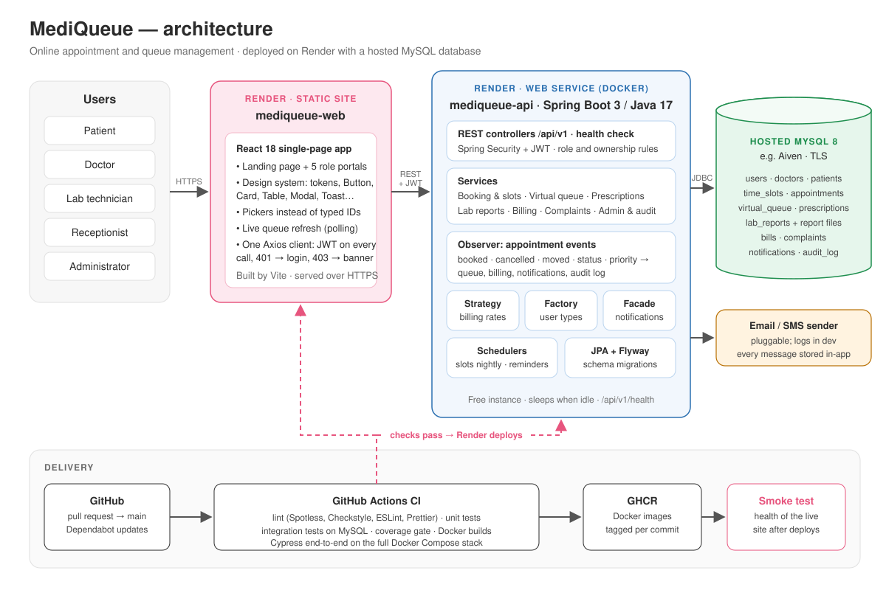

# MediQueue — Online Appointment and Queue Management System

Hospital web app for booking doctor appointments, running a live queue per doctor, and keeping prescriptions, lab reports, bills and complaints in one place.

## Architecture



## Features by role

| Role | Can do |
|------|--------|
| Patient | Sign up, find doctors, book / cancel / reschedule, view prescriptions, lab reports, bills and medical record, raise complaints |
| Doctor | Run the daily queue, view patient history, issue prescriptions |
| Lab Technician | Find an appointment, upload reports (PDF / PNG / JPEG, max 10 MB) |
| Receptionist | Manage and book appointments, mark high priority, collect payments |
| Administrator | Manage users, doctors and departments, slot settings, queue override, complaints, alerts, audit log |

Every user has a **My Profile** page and gets in-app notifications. Visitors see a landing page.

## Key rules

- **Queue:** patients already called stay at the front; then high priority, then slot time. Screens refresh every 5 s.
- **Slots:** generated from admin Slot Settings (default 30 min, 09:00–17:00, Mon–Sat, 7 days ahead).
- **Cancel / reschedule:** patients up to 2 hours before the slot; staff any time before it.
- **Billing:** emergency 150% (high priority), follow-up 50%, standard 100%. Cancelled visits are voided or refunded.
- **Access:** patients see only their own data; doctors only their own patients.
- **Accounts:** only patients sign up. Staff accounts are created by the admin with a temporary password.
- **Deactivated doctor:** their upcoming appointments are cancelled and the patients notified.
- **Time zone:** Asia/Kolkata (`APP_TIMEZONE`).

## Design patterns

| Pattern | Where |
|---------|-------|
| Factory | `factory/UserFactory` — creates the right user type per role |
| Strategy | `billing/` — pricing rules |
| Observer | `event/` — queue, billing, notifications and audit react to appointment changes |
| Facade | `service/facade/NotificationFacade` — stores and sends notifications |

## Tech stack

| Layer | Technology |
|-------|------------|
| Backend | Java 17, Spring Boot 3.5, Spring Security + JWT, Flyway, Maven |
| Database | MySQL 8 |
| Frontend | React 18, Vite 5, React Router 6, Axios, own design system (`src/components/ui`) |
| Testing | JUnit 5, Mockito, Spring Boot integration tests, JaCoCo, Jest, React Testing Library, Cypress |
| Quality | Spotless, Checkstyle, ESLint, Prettier |
| DevOps | Docker Compose, Nginx, GitHub Actions, GHCR, Render |

## Project structure

```
├── docker-compose.yml     # MySQL + backend + frontend
├── render.yaml            # Render deployment (API + website)
├── docs/                  # architecture diagram, deployment guide
├── db/migrations/         # upgrades for databases created before Flyway
├── mediqueue-backend/     # Spring Boot REST API (/api/v1), schema in src/main/resources/db/migration
└── mediqueue-frontend/    # React app, Cypress end-to-end tests
```

## Run with Docker

```bash
docker compose up --build
```

- Frontend: http://localhost
- Backend: http://localhost:8080/api/v1 (health: `/api/v1/health`)
- MySQL: localhost:3307

The backend creates the tables on first start. Optional settings: copy `.env.example` to `.env`. Reset the database: `docker compose down -v`.

## Run locally

Needs Java 17+, Maven, Node.js 20+ and MySQL 8.

```bash
mysql -u root -p -e "CREATE DATABASE mediqueue"
cd mediqueue-backend && mvn spring-boot:run
cd mediqueue-frontend && npm install && npm run dev
```

Open http://localhost:5173. The backend uses MySQL user `root` / `root@123` by default (`SPRING_DATASOURCE_USERNAME`, `SPRING_DATASOURCE_PASSWORD`) and creates the tables itself.

An existing database from before Flyway: run any of `db/migrations/*.sql` it is missing, in name order, then start the backend.

## Demo accounts

Created automatically on an empty database (`APP_SEED_ENABLED=false` turns this off).

| Username | Role |
|----------|------|
| `admin` | Administrator |
| `reception` | Receptionist |
| `labtech` | Lab Technician |
| `patient` | Patient |
| `dr.mehta`, `dr.iyer`, `dr.rao` … (10 doctors) | Doctor |

Passwords: `APP_SEED_ADMIN_PASSWORD` and `APP_SEED_DEFAULT_PASSWORD` (see `.env.example`; set your own on Render).

## Tests, linting and formatting

```bash
cd mediqueue-backend && mvn verify            # unit tests + format check + Checkstyle
cd mediqueue-backend && mvn spotless:apply    # format Java
cd mediqueue-frontend && npm test             # Jest tests
cd mediqueue-frontend && npm run lint         # ESLint
cd mediqueue-frontend && npm run format       # Prettier
cd mediqueue-frontend && npx cypress run      # end-to-end (app running, empty seeded database)
```

- **Integration tests** (`*IT.java`) run in `mvn verify` when `IT_DATASOURCE_URL` points at an empty MySQL database, e.g. `jdbc:mysql://localhost:3306/mediqueue_it?createDatabaseIfNotExist=true`.
- **Coverage:** JaCoCo report in `mediqueue-backend/target/site/jacoco`; CI requires 70% line coverage of the business logic.

## CI/CD

- **Every pull request:** lint, unit tests, integration tests on MySQL, coverage gate, Docker builds, Cypress on the full stack.
- **Merge to main:** images pushed to GitHub Container Registry; Render deploys once the checks pass.
- **Dependabot:** weekly dependency update PRs.
- **Smoke test:** `smoke-test.yml` checks the live site (run by hand, and daily).

## Deploy on Render

`render.yaml` creates the API (Docker, free) and the website (static, free); MySQL is hosted on Aiven. Step-by-step guide: [docs/deployment.md](docs/deployment.md).

## Limitations

- Email / SMS is not connected; notifications are in-app only.
- No online payment; the front desk records payments.
- On Render's free plan the API sleeps when idle, so the first request takes about a minute and reminders only run while it is awake.
